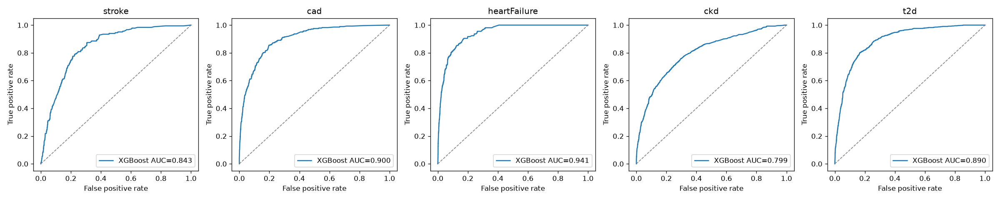

# CareFlow risk models — results (FR-9.2, FR-9.3, Objective 2)

Trained 2026-10-12T21:29:35+00:00 with scikit-learn 1.9.1 and XGBoost 3.2.0 (seed 42).
Data: NHANES 2011-2018 adults (age >= 20), US CDC, public domain (D-29). Method: `src/train.py`; decisions D-29, D-30, D-31.

## Discrimination (ROC AUC)

CV = 5-fold cross-validation on the 80% training split (used for model selection);
Test = untouched 20% held-out split. Final = selected model after isotonic calibration.

| Complication | Adults (cases) | Prevalence | CV RF | CV XGB | Test RF | Test XGB | Selected | **Final test AUC** | ≥ 0.80 |
|---|---|---|---|---|---|---|---|---|---|
| Stroke | 22,592 (913) | 4.0% | 0.841 | 0.843 | 0.844 | 0.842 | XGBoost | **0.843** | ✅ |
| Coronary artery disease | 22,616 (1,416) | 6.3% | 0.900 | 0.902 | 0.899 | 0.900 | XGBoost | **0.900** | ✅ |
| Heart failure | 22,565 (784) | 3.5% | 0.919 | 0.922 | 0.939 | 0.940 | XGBoost | **0.941** | ✅ |
| Chronic kidney disease | 22,601 (4,129) | 18.3% | 0.789 | 0.793 | 0.791 | 0.799 | XGBoost | **0.799** | ⚠️ below |
| Type 2 diabetes | 22,602 (3,146) | 13.9% | 0.879 | 0.883 | 0.886 | 0.890 | XGBoost | **0.890** | ✅ |

## Hypertensive subgroup (same held-out test set)

The platform's users have hypertension. Within that subgroup the outcomes are harder
to separate, so discrimination is lower; reported here as a limitation.

| Complication | Hypertensive test adults | Test AUC |
|---|---|---|
| Stroke | 1,669 | 0.728 |
| Coronary artery disease | 1,668 | 0.849 |
| Heart failure | 1,653 | 0.880 |
| Chronic kidney disease | 1,692 | 0.759 |
| Type 2 diabetes | 1,668 | 0.821 |

## Risk levels (D-30)

Fixed cut-points on the calibrated probability, from the 50th / 80th / 95th
percentiles of predicted risk on the training split; not adjustable at runtime.

| Complication | Moderate ≥ | High ≥ | Critical ≥ |
|---|---|---|---|
| Stroke | 1.3% | 6.9% | 17.6% |
| Coronary artery disease | 1.3% | 8.4% | 29.8% |
| Heart failure | 0.5% | 3.1% | 19.8% |
| Chronic kidney disease | 10.4% | 28.8% | 60.9% |
| Type 2 diabetes | 3.8% | 26.5% | 58.8% |

## Inputs

All inputs are values the app collects (D-29, D-31): age, sex, systolic and diastolic BP
(mean of the last three readings), heart rate, BMI, smoking status, family history,
hypertension, high cholesterol, BP medication, medication count, and the other four
complications as existing conditions. Laboratory values define the CKD outcome only
(eGFR CKD-EPI 2021 < 60 mL/min/1.73m² or urine ACR ≥ 30 mg/g) and are never inputs.
Adherence rate and days since last reading are part of the platform's twelve inputs
but are not available in NHANES, so they are not model inputs.

## Limitations

- Cross-sectional data: scores express association with having each complication,
  not a validated 10-year incidence.
- US population (NHANES); not validated on Malaysian patients (Ch1 limitation).
- Outcomes other than CKD are self-reported diagnoses.
- Part of the discrimination comes from existing conditions (comorbidity).
- Chronic kidney disease narrowly misses the 0.80 target: CKD is defined by laboratory
  tests the app does not collect.
- Discrimination is lower within the hypertensive subgroup (table above).
- Scores are estimates for prioritisation, not diagnoses.
